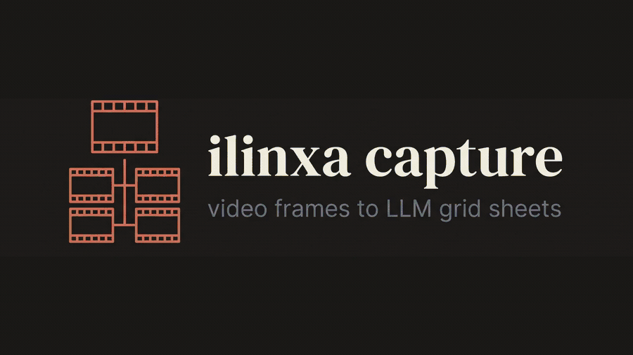
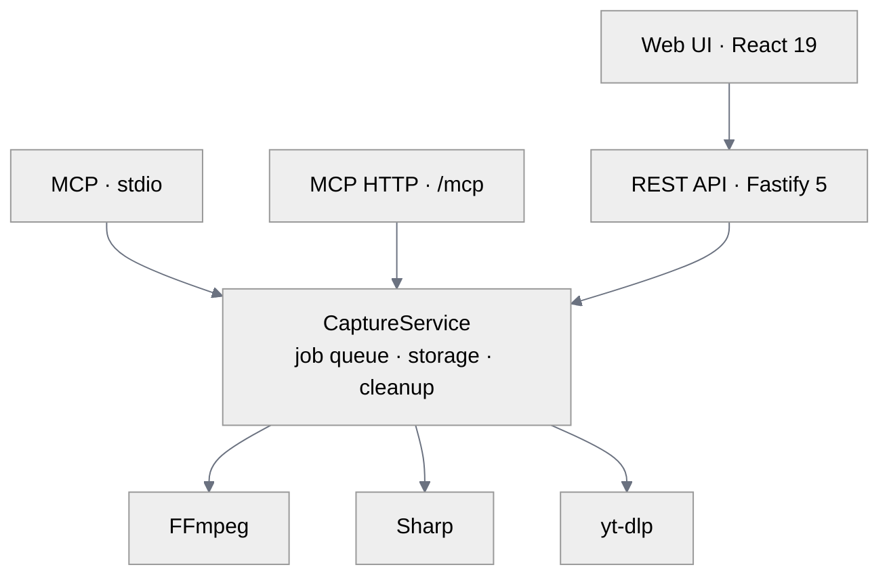

<!-- wl:readme.hero -->
<p align="center">
  
</p>

# ilinxa capture

**Video frame extraction & composition service for AI vision pipelines.**

[](https://github.com/ilinxa/ilinxa-capture/actions/workflows/ci.yml)
[](LICENSE)


<!-- /wl -->

<!-- wl:readme.about -->
ilinxa capture extracts video frames and tiles them into 2×2 or 4×4 grid sheets
a multimodal LLM can read in one image, self-hosted, via a REST API, a Web UI,
or an MCP server. Instead of sending a model dozens of separate frames, you send
one contact sheet, with optional frame-number and timestamp overlays so the
model can still reason about time. It also finds the shots in a film and pulls
its audio, and every frame carries its real time in the source, so picture,
shots and sound line up. One core engine backs all three interfaces:

| Interface | For | Entry point |
|---|---|---|
| **REST API** | Scripts, services, pipelines | `/api/v1` |
| **Web UI** | Interactive use | `/` (3-step wizard) |
| **MCP server** | AI agents / MCP clients | stdio + Streamable HTTP |
<!-- /wl -->

<!-- wl:readme.toc -->
## Table of contents

- [Demo](#demo)
- [Features](#features)
- [Quick start](#quick-start)
- [Usage](#usage)
  - [REST API](#rest-api)
  - [Working with a film](#working-with-a-film)
  - [Web UI](#web-ui)
  - [MCP server](#mcp-server)
- [Configuration](#configuration)
- [Architecture](#architecture)
- [Development](#development)
- [Testing](#testing)
- [Security model](#security-model)
- [FAQ](#faq)
- [Contributing](#contributing)
- [Support](#support)
- [License](#license)
<!-- /wl -->

<!-- wl:readme.demo -->
## Demo

<p align="center">
  
</p>

Video in, one grid sheet out — 16 frames tiled into a single 4×4 image with
per-frame timestamp overlays, ready for a multimodal LLM. [Watch the clip](assets/brand/demo.mp4).
<!-- /wl -->

<!-- wl:readme.features -->
## Features

- **Frame extraction** at any rate up to 30 FPS, or one frame every N seconds,
  via FFmpeg. Each frame reports its real time in the source
- **Time ranges** with `start` and `end`, in seconds or timecode, exact to the
  frame on the containers listed under [Configuration](#configuration)
- **Shot detection** by scene cuts, with first, middle and last frames per shot
- **Audio extraction** by stream, with sample rate, channels and range, on the
  same timeline as the frames
- **Grid composition** into 1×1, 2×2, or 4×4 sheets via Sharp, with optional
  frame-number and timestamp overlays
- **Quality presets** tuned for vision models: `llm` (1024 px, JPEG 80 %),
  `high` (original resolution, PNG), or fully `custom`
- **Video download** from YouTube, Vimeo, and 1,000+ sites via yt-dlp, with
  per-resolution presets or raw format selectors
- **HLS support**: parse master playlists, discover `.m3u8` streams embedded
  in web pages, download variants (custom headers supported for protected
  streams)
- **Sync or async jobs**: async returns `202` + poll URL and supports webhook
  notifications on completion. Jobs can be stopped, and a job left behind by a
  caller who hangs up stops itself
- **Streaming ZIP downloads** of frames, sheets, or both, never buffered in
  memory
- **Self-maintaining storage**: TTL-based cleanup of finished jobs and
  orphaned temp files; job state recovers across restarts (no database)
<!-- /wl -->

<!-- wl:readme.quickstart -->
## Quick start

### Docker (recommended)

```bash
docker build -t ilinxa-capture .
docker run -p 127.0.0.1:3000:3000 ilinxa-capture
```

Open <http://localhost:3000>. The Web UI, REST API, and MCP HTTP endpoint are
all served from the same port. FFmpeg and yt-dlp are included in the image.

Keep the `127.0.0.1:` in that command. There is no login, and without it Docker
publishes the port to your whole network.

To read films from disk instead of uploading them, mount the folder and allow it:

```bash
docker run -p 127.0.0.1:3000:3000 \
  -v /media/films:/films:ro -e ALLOWED_INPUT_DIRS=/films ilinxa-capture
```

### Local

Requires **Node 22+**, **FFmpeg 5.1+** (with ffprobe) and **yt-dlp** on `PATH`.

```bash
npm ci
cd ui && npm ci && npm run build && cd ..
npm run build
npm start                  # serves API + built UI on 127.0.0.1:3000
```

For development with hot reload, see [Development](#development).
<!-- /wl -->

<!-- wl:readme.usage -->
## Usage

### REST API

Extract frames and compose a 2×2 sheet in one call:

```bash
curl -X POST http://localhost:3000/api/v1/extract-and-compose \
  -H "Content-Type: application/json" \
  -d '{
    "source": "https://example.com/video.mp4",
    "fps": 2,
    "mode": 4,
    "preset": "llm",
    "overlay_timestamp": true
  }'
```

Or upload a file (multipart):

```bash
curl -X POST http://localhost:3000/api/v1/extract \
  -F "file=@video.mp4" -F "fps=2" -F "preset=llm"
```

Over HTTP, a local path as `source` is refused unless it sits inside the output
folder or a folder named in `ALLOWED_INPUT_DIRS`. Upload the file, or allow the
folder.

Add `"async": true` (or `-F "async=true"`) to get an immediate `202` with a
poll URL instead of waiting for the result. Pass `"webhook_url"` to be called
back on completion.

#### Endpoints

| Method | Path | Description |
|---|---|---|
| `POST` | `/api/v1/metadata` | Probe a video (file upload or `{source}`) |
| `POST` | `/api/v1/extract` | Extract frames |
| `POST` | `/api/v1/compose` | Compose frames into grid sheets |
| `POST` | `/api/v1/extract-and-compose` | Both steps in one call |
| `POST` | `/api/v1/shots` | Find shots, with frames from each |
| `POST` | `/api/v1/audio` | Extract an audio stream |
| `POST` | `/api/v1/video/formats` | List downloadable formats for a URL |
| `POST` | `/api/v1/video/download` | Download a video (preset or raw selector) |
| `POST` | `/api/v1/hls/discover` | Scan a web page for embedded HLS streams |
| `GET` | `/api/v1/jobs/:id` | Job status / result |
| `DELETE` | `/api/v1/jobs/:id` | Stop a job, then delete it and its files |
| `GET` | `/api/v1/jobs/:id/download?include=frames\|sheets\|all` | Streaming ZIP |
| `GET` | `/api/v1/jobs/:id/video` | Download a downloaded video file |
| `GET` | `/api/v1/files/:jobId/*` | Serve a frame, sheet, audio file or `manifest.json` |
| `GET` | `/api/v1/health` | Health check |

Errors are consistent JSON:
`{ "error": { "code": "VALIDATION_ERROR", "message": "fps: expected number" } }`
with meaningful HTTP status codes (`400`, `403`, `404`, `409`, `410`, `413`,
`500`, `504`). A file that cannot be read as a video is a `400` that says why.

Full endpoint documentation with request/response schemas:
[docs/GUIDE.md](docs/GUIDE.md).

### Working with a film

Two limits are set for short clips: `MAX_VIDEO_DURATION` (10 minutes) and
`JOB_TIMEOUT` (5 minutes). The duration limit applies to the span you process,
so one scene of a long film works as it stands:

```bash
curl -X POST http://localhost:3000/api/v1/extract \
  -H "Content-Type: application/json" \
  -d '{ "source": "/films/feature.mkv", "fps": 1, "start": "01:12:30", "end": "01:14:00" }'
```

For a whole film, set `MAX_VIDEO_DURATION=0` and `JOB_TIMEOUT=0` and send
`"async": true`. Find the shots, then read the job's `manifest.json` for every
frame's real time, its shot, and which sheet holds it:

```bash
curl -X POST http://localhost:3000/api/v1/shots \
  -H "Content-Type: application/json" \
  -d '{ "source": "/films/feature.mkv", "frame_positions": ["first", "last"], "async": true }'
```

Audio uses the same timeline. Add `timeline_offset` from the result to a time in
the audio to get a time in the film.

```bash
curl -X POST http://localhost:3000/api/v1/audio \
  -H "Content-Type: application/json" \
  -d '{ "source": "/films/feature.mkv", "format": "flac", "stream": 1, "start": "01:12:30", "end": "01:14:00" }'
```

Times are real source frame times, so a clip with gaps returns fewer frames than
`duration × fps` rather than repeating held ones. Known limits are in
[docs/GUIDE.md](docs/GUIDE.md).

### Web UI

A three-step wizard, **Extract → Preview & Compose → Output**, with file upload
or URL input, live metadata preview, an HLS stream scanner, frame gallery, grid
configuration, and ZIP downloads. Light and dark themes. Shots, audio and time
ranges are API and MCP features for now.

### MCP server

ilinxa capture exposes its tools to any
[Model Context Protocol](https://modelcontextprotocol.io/) client.

**Tools:** `capture_metadata`, `capture_extract`, `capture_compose`,
`capture_extract_and_compose`, `capture_shots`, `capture_audio`,
`capture_video_formats`, `capture_video_download`, `capture_hls_discover`,
`capture_job_status`, `capture_job_manifest`, `capture_job_delete`.

Every tool that starts work takes `async: true`, so a long run can outlive a
client's request timeout. Results stay short on big jobs: long lists are cut, and
`capture_job_manifest` pages through the rest. Cancelling a call stops its job.

**Stdio** (local clients, e.g. Claude Desktop, Cursor, VS Code). Local paths work
as `source` here, because the server runs as you, on your machine. Output goes to
`~/.ilinxa-capture/jobs` unless `LOCAL_OUTPUT_DIR` says otherwise.

```json
{
  "mcpServers": {
    "ilinxa-capture": {
      "command": "node",
      "args": ["/absolute/path/to/ilinxa-capture/dist/mcp-entry.js"]
    }
  }
}
```

**Streamable HTTP** (remote agents): the running server exposes `/mcp`
(POST/GET/DELETE) with session management and idle-session expiry
(`MCP_SESSION_TTL`). The same path rules as the REST API apply.

Setup walkthroughs for both transports: [docs/GUIDE.md](docs/GUIDE.md#mcp-server).
<!-- /wl -->

<!-- wl:readme.config -->
## Configuration

All configuration is via environment variables (validated at startup: the
server refuses to boot on invalid config). Copy [`.env.example`](.env.example)
to `.env` to get started. Real environment variables win over the file.

| Variable | Type | Default | Description |
|---|---|---|---|
| `PORT` | int | `3000` | HTTP port |
| `HOST` | string | `127.0.0.1` | Bind address. Anything but loopback logs a warning at startup |
| `NODE_ENV` | enum | `production` | `development` / `production` / `test`. Never read from `.env` |
| `ALLOWED_HOSTS` | list | none | Extra `Host` names to accept. Loopback and the bind address always work; `*` turns the check off |
| `ALLOWED_ORIGINS` | list | none | Web origins allowed to call the API; `*` turns the check off |
| `ALLOWED_INPUT_DIRS` | list | none | Folders callers may read. Empty means the output folder only over HTTP, any path over stdio; `*` allows any path |
| `LOG_LEVEL` | enum | `info` | Pino log level |
| `STORAGE_MODE` | enum | `local` | `local`. `s3` is checked at startup but not implemented, so output stays on local disk |
| `LOCAL_OUTPUT_DIR` | string | `./data/jobs` | Job output directory (`~/.ilinxa-capture/jobs` over stdio) |
| `LOCAL_TTL_SECONDS` | int | `86400` | Finished-job retention before cleanup |
| `MAX_VIDEO_DURATION` | int | `600` | Longest span to process, in seconds. `0` means no limit |
| `MAX_UPLOAD_SIZE` | int | `524288000` | Max upload size in bytes (500 MB) |
| `MAX_CONCURRENT_JOBS` | int | `3` | Processing concurrency limit |
| `JOB_TIMEOUT` | int | `300` | Per-job timeout in seconds. `0` means no limit |
| `MAX_SHEET_EDGE` | int | `2000` | Longest edge of `llm` grid sheets in pixels. `0` means no limit |
| `MCP_SESSION_TTL` | int | `1800` | Idle MCP HTTP session lifetime in seconds |
| `UI_DIR` | string | `./ui/dist` | Built Web UI assets |
| `S3_*` | — | — | Required by the startup check when `STORAGE_MODE=s3` |

Lists are comma-separated, except `ALLOWED_INPUT_DIRS`, which uses `;` on Windows
and `:` elsewhere.

**Containers read:** MP4, MOV, MKV, WebM, AVI, MPEG-TS, MPEG-PS, FLV, WMV, Ogg,
MXF, DV, IVF, and raw H.264, HEVC or MPEG video. Anything else is refused with a `400`,
including playlists and list files, so a media file can never pull in other files.
<!-- /wl -->

<!-- wl:readme.architecture -->
## Architecture



*One core engine sits behind thin protocol adapters and shells out to FFmpeg and
yt-dlp, with Sharp for composition.*

Design decisions worth knowing:

- **No database.** Job state lives in a `job.json` per job directory,
  schema-validated and reconstructed on startup. Interrupted jobs are marked
  failed, and work interrupted on a finished job is undone.
- **One service.** `CaptureService` owns every pipeline, and options are defined
  once in `src/core/options.ts`. A test fails if REST and MCP drift apart.
- **True timeline.** Frame times come from FFmpeg's own frame timestamps, never
  from `index / fps`. Reasons are in [docs/adr](docs/adr).
- **App factory.** `buildApp()` creates the configured Fastify instance;
  `index.ts` just starts it, which is what makes the whole API testable.
- **External binaries with argument arrays**, so no shell interpolation anywhere.
- **Bounded resources.** A concurrency-limited queue that holds a job's slot until
  its processes are really gone, TTL cleanup for job dirs *and* orphaned temp
  files, and idle-session expiry on the MCP HTTP transport.

```
src/
├── app.ts            # Fastify app factory
├── index.ts          # Server entry (graceful shutdown)
├── mcp-entry.ts      # MCP stdio entry
├── core/             # Engine: service, extractor, shots, audio, composer,
│                     #   metadata, downloader, hls, job-manager, storage, cleanup
├── api/              # REST routes, handlers, schemas (+ api/lib helpers)
├── mcp/              # MCP server + tool registration
├── lib/env.ts        # Zod-validated environment
└── utils/            # Errors, logger, exec

ui/src/
├── app/              # Shell, providers, router
├── features/         # extraction / preview / output (components + api + types)
├── components/       # ui (shadcn) · common · layout
├── stores/           # Zustand (client state)
├── hooks/ lib/ types/ styles/
```
<!-- /wl -->

<!-- wl:readme.development -->
## Development

```bash
# Backend (repo root)
npm ci
npm run dev            # tsx watch on :3000

# Web UI (separate terminal)
cd ui && npm ci
npm run dev            # Vite on :5173, proxies /api to :3000
```

| Command | Where | Description |
|---|---|---|
| `npm run dev` | root / `ui/` | Dev server with hot reload |
| `npm run build` | root / `ui/` | Production build (tsup / Vite) |
| `npm run typecheck` | root / `ui/` | `tsc --noEmit` |
| `npm test` | root / `ui/` | Unit tests (Vitest) |
| `npm run test:integration` | root | End-to-end pipeline tests (real FFmpeg) |
| `npm run test:coverage` | root | Coverage report |
| `npm run lint` / `format` | `ui/` | ESLint / Prettier |
| `npm run mcp:stdio` | root | MCP server on stdio |

Conventions: strict TypeScript everywhere (`noUncheckedIndexedAccess`), ESM
only, Zod validation at every boundary, Pino logging (stdout is reserved for
JSON-RPC on the MCP stdio transport). UI: named exports, Zustand for client
state, TanStack Query for server state — never mixed.
<!-- /wl -->

<!-- wl:readme.testing -->
## Testing

Three tiers, all run in CI. The backend tiers run on Linux and Windows, and
again on FFmpeg 5.1, the minimum version:

| Tier | Count | What it proves |
|---|---|---|
| Backend unit | 543 tests / 35 files | All logic, with FFmpeg, yt-dlp and Sharp mocked where they would be slow |
| Backend integration | 191 tests / 8 files | The **real pipeline** over the live API, with real FFmpeg and yt-dlp. Test clips carry each frame's number in their pixels, so range and shot tests prove which frame came back, not just its label, across seven kinds of source |
| UI | 19 tests / 4 files | Store, API client, polling hook, wizard navigation guards (Vitest + Testing Library) |

```bash
npm test -- --run                 # unit
npm run test:integration -- --run # integration (needs FFmpeg, and yt-dlp for URL tests)
cd ui && npm test -- --run        # UI
```

Integration tests skip URL sources if yt-dlp is not on `PATH`, so check the count.
<!-- /wl -->

<!-- wl:readme.security -->
## Security model

ilinxa capture is designed for **localhost or a trusted network** and ships with
no authentication. By design it will fetch **any URL it is given** (yt-dlp, HLS
discovery, direct HTTP), so it must never be exposed directly to the public
internet or untrusted callers.

The defaults are closed. The server binds to `127.0.0.1`, and the documented
Docker command publishes on loopback only. Every route checks `Host` and `Origin`,
which stops other websites reaching the server through your browser. That check
stops browsers, not a client on your network: if you bind to `0.0.0.0`, anyone who
can reach the port can use it, and the server warns about this at startup.

Over HTTP, local paths are refused unless they sit in the output folder or a
folder you allow. Over stdio any path your user can read is accepted, because
the server runs as you on your own machine. Only local files in known media
containers are opened, so a file cannot pull in other files or URLs.

For anything internet-facing, put it behind a gateway that provides
authentication, rate limiting, and URL allow-listing. The reasoning is in
[ADR 0001](docs/adr/0001-local-first-trust-boundary.md).

To report a vulnerability, see [SECURITY.md](SECURITY.md).
<!-- /wl -->

<!-- wl:readme.faq -->
## FAQ

**How is this different from sending raw video frames to an LLM?**
A grid sheet packs many frames into one image, so the model reads a whole clip
in a single request instead of dozens, with fewer tokens and fewer round trips.
Optional timestamp and frame-number overlays keep the model able to reason
about *when* something happens.

**Do I need FFmpeg and yt-dlp installed?**
For a local install, yes. Both must be on your `PATH` (FFmpeg 5.1 or newer for
extraction, yt-dlp for URL downloads). The Docker image bundles them, so
`docker run` needs nothing else.

**Can it handle a full-length film?**
Yes. A range of a film works under the default limits. For the whole film, set
`MAX_VIDEO_DURATION=0` and `JOB_TIMEOUT=0` and run the job with `async`. See
[Working with a film](#working-with-a-film).

**Can I use it without the Web UI, just the API or an MCP agent?**
Yes. The REST API, Web UI, and MCP server are independent front doors to the same
engine; run only the one you need.

**Which video sources can it pull from?**
Uploads, local files in folders you allow, direct video URLs, HLS streams
(including `.m3u8` links discovered inside a web page), and any of the 1,000+
sites yt-dlp supports.

**Why was my GIF refused?**
Only the containers listed under [Configuration](#configuration) are read. GIF,
Y4M, NUT, RealMedia, MJPEG and OBU are not on that list.

**Is it safe to expose on the internet?**
Not as-is. It has no authentication and will fetch any URL it's given. Keep it
on localhost or a trusted network, or put it behind a gateway. See the
[security model](#security-model).
<!-- /wl -->

<!-- wl:readme.contributing -->
## Contributing

Contributions are welcome — see [CONTRIBUTING.md](CONTRIBUTING.md "wl:contributing.intro")
for the development workflow, test requirements, and PR guidelines. By
participating you agree to the [Code of Conduct](CODE_OF_CONDUCT.md).
<!-- /wl -->

<!-- wl:readme.support -->
## Support

Questions and usage help go in
[GitHub Discussions](https://github.com/ilinxa/ilinxa-capture/discussions); bugs
and feature requests go in [Issues](https://github.com/ilinxa/ilinxa-capture/issues/new/choose).
See [SUPPORT.md](SUPPORT.md) for the full routing.
<!-- /wl -->

<!-- wl:readme.license -->
## License

Apache License 2.0 — see [LICENSE](LICENSE) and [NOTICE](NOTICE).
<!-- /wl -->
